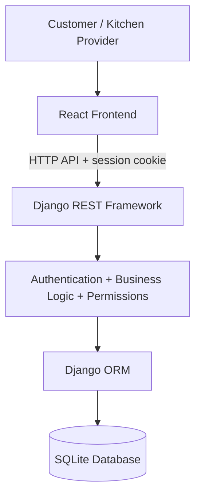

# Apna Tiffin

**Ghar jaisa khana, apno jaisa pyaar.**

Apna Tiffin connects customers with neighborhood home kitchens. Customers can browse menus and place trackable orders; kitchen providers manage their kitchen, tiffins, and order status.

## Features

- Customer and kitchen-provider registration, login, and role-protected pages.
- Database-backed kitchen and tiffin discovery with kitchen/locality/tiffin search, cuisine, food preference, meal-time, dish type, plan duration, maximum-price filters, and price/name sorting.
- Provider-owned kitchen profiles and tiffin menu management.
- Database-backed orders with delivery details, price/name snapshots, and validated status transitions.
- Customer order history, order details, and pending-order cancellation.
- Django Admin for staff/superusers.
- Responsive React interface with loading, empty, validation, and error states.

## Technology and architecture

- React 18, Vite, JavaScript, React Router, Lucide React, and plain CSS.
- Django 6, Django REST Framework, Django sessions, and CSRF protection.
- SQLite in local development; Django ORM/migrations keep the schema portable to PostgreSQL.
- Same-site session cookies are sent by the browser to the local API. The frontend fetches a CSRF cookie before unsafe requests; user identity and business data are always read from the backend.



### Main data entities

- `User` — unique email, name, role, and Django-hashed password.
- `CustomerProfile` — optional customer phone and default delivery address.
- `Kitchen` — one kitchen per provider, address, locality, contact, preferences, and active state.
- `Tiffin` — kitchen-owned menu entry, cuisine, meal time, food preference and dish type, optional plan duration, decimal price, and availability.
- `Order` and `OrderItem` — customer/kitchen relationship, delivery snapshot, status, total, plus tiffin name/unit-price snapshots.

### Order workflow

`PENDING → ACCEPTED → PREPARING → READY → COMPLETED`

A provider may instead reject a pending order (`PENDING → REJECTED`). A customer may cancel their own pending order (`PENDING → CANCELLED`). Terminal states cannot be reopened. The API validates every transition and calculates the total from the current server-side tiffin price.

## Windows setup

Prerequisites: Python 3.12+ (Python 3.14 works with the dependencies below), Node.js 20+, and npm.

Open a PowerShell terminal in the project root:

```powershell
python -m venv .venv
.\.venv\Scripts\Activate.ps1
python -m pip install --upgrade pip
pip install -r requirements.txt
```

The `.env.example` files document the supported settings; Django reads environment variables directly and does not parse `.env` files. For local PowerShell use, the defaults are development-safe. For custom values, set them in the terminal before starting Django:

```powershell
$env:DJANGO_DEBUG = "true"
$env:FRONTEND_ORIGIN = "http://localhost:5173"
```

Apply the schema and (optionally) seed fictional sample listings:

```powershell
python backend\manage.py migrate
python backend\manage.py seed_demo
```

The repeatable seed command creates three clearly named `Demo · ...` kitchens and fictional sample tiffins across North and South Indian cuisines, meal types, food preferences, and daily/weekly/monthly plans. Their provider emails use the reserved `example.invalid` domain and have unusable passwords; they are sample listings, not accounts that can log in. Existing non-demo kitchens and provider passwords are not overwritten. No sample orders or administrator credentials are created.

Create an administrator interactively:

```powershell
python backend\manage.py createsuperuser
```

Start Django in one terminal:

```powershell
python backend\manage.py runserver
```

In a second terminal, from the project root:

```powershell
Set-Location frontend
npm install
npm run dev
```

Open `http://localhost:5173`. The API is at `http://localhost:8000/api/` and the admin at `http://localhost:8000/admin/`.

To set a production secret, disable debug, and configure allowed hosts, set environment variables before starting Django. Do not use the local debug defaults in production:

```powershell
$env:DJANGO_DEBUG = "false"
$env:DJANGO_SECRET_KEY = "<long-random-secret>"
$env:DJANGO_ALLOWED_HOSTS = "your-domain.example"
$env:FRONTEND_ORIGIN = "https://your-domain.example"
```

## API overview

All API responses use JSON. Authentication is Django session-based and authenticated write requests require CSRF.

| Method | Endpoint | Purpose |
|---|---|---|
| GET | `/api/auth/csrf/` | Initialize the CSRF cookie |
| POST | `/api/auth/register/` | Register a customer or provider |
| POST | `/api/auth/login/` | Sign in |
| POST | `/api/auth/logout/` | Sign out |
| GET | `/api/auth/me/` | Current signed-in user |
| GET, PATCH | `/api/auth/profile/` | View/update profile |
| GET | `/api/kitchens/` | Browse/search/filter active kitchens |
| GET | `/api/kitchens/{id}/` | Kitchen details and available tiffins |
| GET, POST, PATCH, DELETE | `/api/kitchens/mine/` | Manage authenticated provider's kitchen |
| GET, POST | `/api/tiffins/` | Browse tiffins or add a provider-owned tiffin |
| GET, PATCH, DELETE | `/api/tiffins/{id}/` | View/update/remove an owned tiffin |
| GET, POST | `/api/orders/` | List authorized orders or place a customer order |
| GET | `/api/orders/{id}/` | View an authorized order |
| PATCH | `/api/orders/{id}/status/` | Make a permitted status transition or cancel |

Kitchen filters: `search` (kitchen name, locality, description, or tiffin name), `preference`, `category` (meal time), `cuisine`, `food_category`, `meal_plan`, `max_price`, and `ordering` (`name`, `price_asc`, or `price_desc`). Food preference and dish/plan filters match actual available tiffins, not just kitchen labels.

## Tests and checks

From the project root:

```powershell
python backend\manage.py test accounts kitchens orders
python backend\manage.py makemigrations --check --dry-run
python backend\manage.py check
```

From `frontend\`:

```powershell
npm run build
```

The automated Django tests cover registration/password hashing, login/logout, role restrictions, kitchen/tiffin ownership, order pricing and snapshots, unavailable tiffins, private-order access, status transitions, and customer cancellation.

## Troubleshooting

- **PowerShell blocks virtual-environment activation:** use `.\.venv\Scripts\python.exe` directly, or adjust the current-user execution policy according to your organization's policy.
- **Frontend cannot reach the API:** confirm both development servers are running and `FRONTEND_ORIGIN` matches the exact browser origin (`http://localhost:5173` by default).
- **CSRF failure:** refresh the frontend and confirm cookies are enabled; the API initializes the CSRF cookie before writes.
- **No kitchens appear:** run `python backend\manage.py seed_demo` or register as a provider, create a kitchen, and add an available tiffin. Demo provider accounts have no usable passwords; register a real customer/provider account to sign in.
- **Database schema mismatch:** run `python backend\manage.py migrate`.
- **Email already registered:** sign in with that address or use a different one; emails are unique.

## Limitations and future improvements

This demonstration does not process online payments, provide live delivery tracking, or integrate external delivery services. Kitchen image uploads are not included; menu images can use an optional image URL, and the UI has local visual fallbacks. Session storage is configured for local development; production deployment should add HTTPS, secret management, a production database, operational monitoring, and deployment-specific cookie/CORS configuration.
